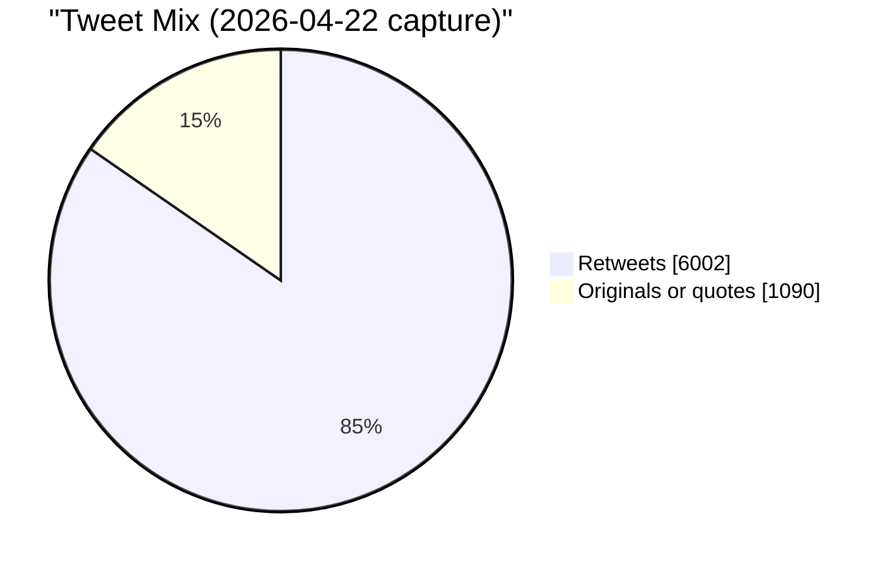
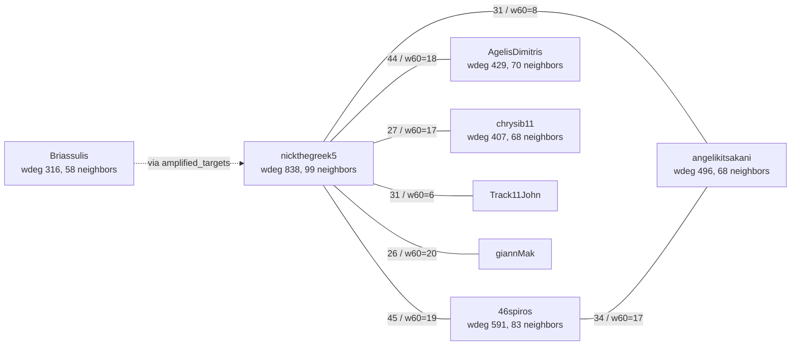
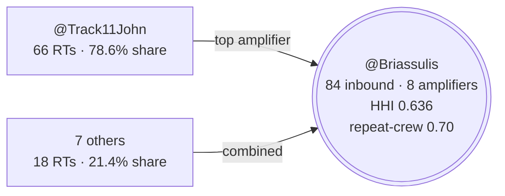
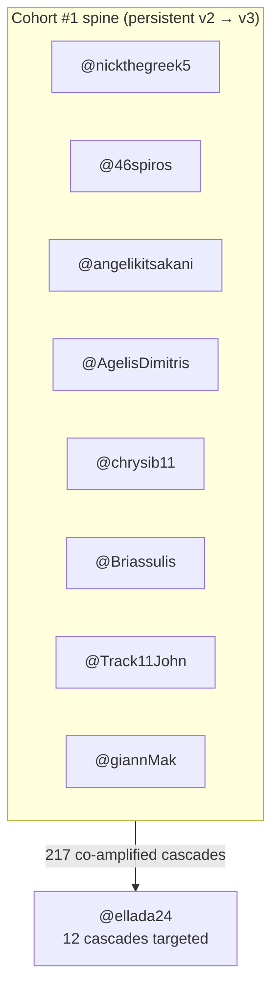
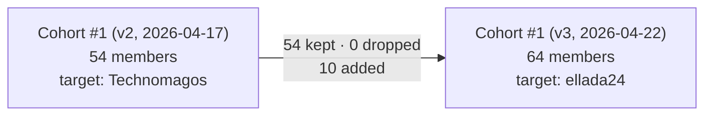
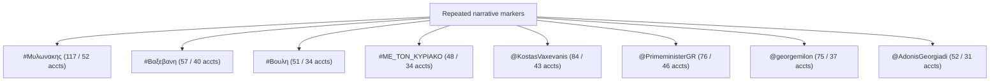

# Reanalysis Post-Mortem

## Revision history

- **v1 (2026-04-15)** — single-window analysis on
  `twitter-web-exporter-1776296731477.json` + `twitter-ListMembers-1776293400829.csv`.
  13-hour window, 197 active accounts, overlap-graph only. Flagged five missing
  layers: lead-lag, cross-day persistence, URL/domain/media reuse, role typology,
  manual labels.
- **v2 (2026-04-17)** — mid-run on
  `batch_exporter-1776380968798__members-1776380931158`. Window widened to
  `2024-10-26 → 2026-04-16`. Intelligence layer landed:
  `account_roles`, `amplified_targets`, `cohorts`, `cohort_members`,
  `cascade_propagation`, `cascade_spread_paths.jsonl`, `first_retweeter_profiles`.
  First cohort surfaced (54 members).
- **v3 (this revision, 2026-04-22)** — latest batch
  `batch_exporter-1776856502784__members-1776856522346`. Same 18-month window
  plus the most recent 5.5 days. Intelligence outputs now run end-to-end and are
  exposed through the visualizer dashboard (overview, cohorts, targets,
  accounts, graph lab, report).

## Scope

This revision is for the run based on:

- `datasets-raw/new/twitter-ListMembers-1776856522346.json`
- `datasets-raw/new/twitter-web-exporter-1776856502784.json`

Captured sample:

- **653** listed accounts (+49 vs v1, +13 vs v2)
- **7,092** tweet rows (+4,893 vs v1)
- **367** active author handles (+170 vs v1, +60 vs v2)
- **6,002** retweets, **1,090** originals or quotes
- Capture window `2024-10-26T18:35:57+00:00 → 2026-04-22T11:11:54+00:00`.
  Note the window is no longer the ~13h of v1. Most tweets still cluster in
  the last two weeks, but the exporter now returns a longer history when
  available.
- **22** author handles appearing in tweets but missing from the member
  export (same structural gap as v1 — worth collecting).

## Two structural changes since v1

### 1. The analysis surface is no longer just the overlap graph

v1 reasoned almost entirely off `account_overlap.csv`, `network_nodes.csv`,
and `network_components.csv`. Those three are now the first layer of five.
Every claim in this revision is backed by at least one of:

- `account_overlap.csv` + `network_nodes.csv` + `network_components.csv` — pair
  co-activity and component shape (same as v1).
- `account_roles.csv` — deterministic per-account role label
  (`source_hub`, `media_business`, `journalist_public_figure`,
  `amplifier_suspect`, `retail_user`, `mixed_behavior`, `unknown`) with a
  confidence score and the literal signals that triggered the label.
- `cohorts.csv` + `cohort_members.csv` — recurrent crews detected via
  label-propagation on a time-tight co-retweet subgraph
  (edges require `shared_within_60m ≥ 2`).
- `amplified_targets.csv` — per-target amplification profile
  (total inbound, unique amplifier count, HHI, repeat-crew Jaccard,
  median first-retweet lag, within-15m inbound, top amplifier + share,
  cross-component reach, captured role mix, composite score).
- `cascade_propagation.csv` + `cascade_spread_paths.jsonl` — per-cascade
  `time_to_k5/k10/k50`, burst kurtosis, same-client share, amplifier cohort
  and component ids, ordered spread path.
- `first_retweeter_profiles.csv` — per account, how often they are first on
  captured cascades plus the target-HHI of their first-retweets.

### 2. We now have three capture windows to reason across

v1 explicitly called out: *"This is still one capture window … we still need
repeated exports across multiple days, component stability checks, edge
persistence checks, role persistence checks."* That blocker is now lifted.
v2 and v3 are two distinct captures on the same list, taken 5 days apart,
with the main intelligence tables computed identically. Persistence claims
below are grounded in v2-vs-v3 diffs, not speculation.

## Cross-window persistence — the main new finding

**The coordination spine identified by v1 survives into both v2 and v3
untouched.** Phrased as a testable claim:

- v1 core names: `nickthegreek5`, `Track11John`, `giannMak`, `46spiros`,
  `AgelisDimitris`, `angelikitsakani`. v3 top weighted-degree nodes:
  `nickthegreek5` (838), `46spiros` (591), `angelikitsakani` (496),
  `AgelisDimitris` (429), `chrysib11` (407), `Briassulis` (316). Same five
  plus `chrysib11` and `Briassulis` moved up in relative rank.
- v3 ML top anomaly ranks 1–3: `nickthegreek5` (#1), `46spiros` (#2),
  `Track11John` (#3). The deterministic spine and the unsupervised anomaly
  ranking agree on the top three, independently.
- **Cohort #1 persistence v2 → v3: 54 of 54 members kept, 0 dropped,
  10 added.** The 10 additions (`Agie2a`, `FrankiKostas`, `Mirsini1946041`,
  `VforVolemenos`, `communakios`, `doubamari`, `evangelia_re`, `fanis_rc`,
  `fifi_apostolou`, `jparthen`) all sit inside the same single connected
  component as the existing 54, and they co-retweeted the same kinds of
  originals (targeted cascades overlap). This is the closest thing the
  current pipeline produces to a "component stability" answer — the
  recurrent crew is stable across 5 days even as the captured window and the
  role/anomaly scoring are recomputed from scratch.
- **Amplified-target leaderboard persistence v2 → v3:** `Briassulis` remains
  the top target in both runs; `enikos_gr` remains #2; the top five overlap
  by four names.

This matters because v1 could see shape; v2/v3 can see shape *across time*.

## Briassulis amplification — stable signature across captures

The single tightest amplification pattern in every version of this analysis
is inbound pressure on `@Briassulis`. The `amplified_targets.csv` row makes
the pattern explicit and very consistent:

| metric                     | v1 (raw edge only) | v2 (2026-04-17) | v3 (2026-04-22) |
| :------------------------- | :----------------- | :-------------- | :-------------- |
| total inbound retweets     | — *(not computed)* | 81              | 84              |
| unique amplifier count     | —                  | 7               | 8               |
| amplification HHI          | —                  | 0.680           | 0.636           |
| top amplifier              | Track11John        | Track11John     | Track11John     |
| top amplifier share        | —                  | 0.815           | 0.786           |
| repeat-crew overlap        | —                  | 0.700           | 0.700           |
| within-15m inbound         | —                  | 77              | 80              |
| median first-retweet lag   | —                  | 3h 45m          | —               |
| captured role mix of amps  | —                  | mixed+media     | mixed+amp+media |
| amplification score        | —                  | 82.96           | 82.39           |

Observations:

- **HHI 0.64–0.68 is extreme concentration** — one amplifier carries ~80% of
  inbound pressure on both captures. This sits well above the
  "organic heavy-retweeter" range we see on other targets (e.g. `enikos_gr`
  inbound 20 from a single amplifier, `L3naRain` inbound 6 from a single
  amplifier — those are one-person fan patterns; `Briassulis` is an 8-person
  crew that behaves like a one-person fan).
- **Repeat-crew overlap locked at 0.70 across both captures.** The top cascades
  for `Briassulis` are amplified by *almost the same seven-to-eight accounts
  every time*, not a shifting crowd. This is the clearest structural
  fingerprint we have.
- **80 of 84 inbound retweets in v3 arrived within 15 minutes of the original.**
  Combined with the HHI and the repeat-crew, that is the signature a
  reasonable analyst would expect from paid/organised amplification rather
  than organic reach.

None of this is proof of payment. It is a stable, reviewable fingerprint
that the network was generating before v2 wrote the tooling to name it.

## Cohorts — the v1 "cluster" claim, now formalised

v1 said the overlap graph "resolves into one main connected component with
61 accounts" and pointed at a six-account core. v2 and v3 formalise that via
the cohort detector (label-propagation on the time-tight subgraph,
recursive split of oversized communities, and a floor of ≥2 co-amplified
cascades).

### Latest cohorts

| id  | members | cascades | tightness | top target        | target HHI | score   |
| :-- | :------ | :------- | :-------- | :---------------- | :--------- | :------ |
| #1  | 64      | 217      | ~50 min   | `ellada24` (12×)  | 0.019      | 52.93   |
| #2  | 41      | 4        | ~34 min   | `Mirsini1946041`  | 0.250      | 39.62   |

Cohort #1 is the coordination field v1 was pointing at — now with explicit
membership (64 handles in the JSON output) and formal inclusion criteria.
Cohort #2 is smaller and looser: only 4 cohort-tagged cascades, concentrated
on a single target (`Mirsini1946041`), which is itself a v1-era heavy
retweeter. This second cohort is worth treating as provisional until we see
whether it survives the next capture.

### Why the top_target HHI looks low

`Cohort #1` has target HHI 0.019. That is *not* a sign of weak signal — it
is because the cohort is big (64 members) and they co-amplify many different
originals. The HHI is computed across the 217 distinct cascades the cohort
co-participated in; no single cascade dominates. The per-target counts
inside the cohort still concentrate around a known few (`ellada24` 12×,
followed by a long tail). The number an analyst should watch is
`target concentration × cohort size × cascade count`, not HHI alone.

### The `GiotaPapapetrou` inside-the-crew anomaly

`GiotaPapapetrou` is first-retweeter on **179** captured cascades — more
than any other account — with first-retweet target HHI of only 0.026
(broadly spread). The deterministic role classifier labels them `retail_user`.
Yet they are inside Cohort #1. This is the kind of mismatch the new tooling
is designed to surface: an account that doesn't look like an amplifier on
profile features but does look like one on co-activity features. Flagging
for manual review rather than re-classifying automatically.

## Cascade propagation — the shape is mostly not a burst

An important rebalancing vs v1. v1 counted retweets and window-15m/60m
counts. v2/v3 compute `time_to_k10_sec` (seconds to reach 10 retweets),
`burst_kurtosis` (peakedness of arrival times), and `same_client_share`
(fraction of retweets from the dominant client). Looking at cohort-tagged
cascades in v3:

- `ellada24`: time_to_k10 ≈ 8,292s (~2.3h), kurtosis 1.20, same-client 0.75.
  This is a **sustained re-retweet**, not a burst. Same-client share 0.75
  suggests a homogeneous device stack.
- `kyranakis`: time_to_k10 ≈ 10,220s (~2.8h), kurtosis 0.72, same-client 0.64.
  Similar slow-sustained shape.
- `Technomagos`: kurtosis 4.70, same-client 0.53 — a **sharp spike** on a
  mixed client stack. Different propagation mode inside the same cohort.

The implication is that "coordination" in this sample is rarely explosive
synchronised bursts. It is a crew that re-retweets the same originals over
hours, with a narrow device fingerprint. That is a useful correction to the
instinct (from v1) that coordinated activity must look like simultaneous
fire-and-forget behaviour.

## Account roles — where the review weight sits

The deterministic classifier over 367 active accounts in v3:

| role                        | count | share |
| :-------------------------- | :---- | :---- |
| unknown                     | 87    | 23.7% |
| mixed_behavior              | 83    | 22.6% |
| amplifier_suspect           | 72    | 19.6% |
| retail_user                 | 56    | 15.3% |
| media_business              | 35    | 9.5%  |
| source_hub                  | 33    | 9.0%  |
| journalist_public_figure    | 1     | 0.3%  |

Where that lands analytically:

- **72 amplifier_suspect accounts is the primary review bucket.** These are
  accounts with retweet_ratio ≥ 0.85, near-zero originals, and typically
  elevated first_retweeter_count or concentrated top_amplified_share — the
  deterministic criteria are spelled out in each account's `signals` field.
- **87 "unknown" is a coverage gap, not a finding.** Most of these are
  private / zero-description profiles where the text classifier has nothing
  to match.
- Only one `journalist_public_figure` label means the regex patterns are
  strict; if the user intends this category to catch opinion-columnists and
  Greek-language public figures more widely, the pattern set needs expanding.
  Worth raising before the next capture.

## v1 signals that held — and the ones that evolved

Held:

- **Narrative concentration is still narrow.** v3 top hashtag is still
  `#Μυλωνακης` (117 occurrences across 52 accounts, vs 39 across who-knows-how-many
  in v1). `#Βαξεβανη` still in the top four. Top mentions still include
  `@KostasVaxevanis`, `@kmitsotakis`, `@AdonisGeorgiadi`, `@georgemilon`.
  v3 surfaces some additions (`#aekfc`, `#OlympiacosBC`) driven by the
  long-tail window including sport content from broader posting activity —
  those are noise for this investigation.
- **ellada24 and AdonisGeorgiadis are sources, not amplifiers.** v3 confirms
  — `ellada24` is the top cohort #1 target (12 cascades) and the #1 source
  by total inbound retweets (140 RTs across 48 posts, 46 unique retweeters).
  `AdonisGeorgiadi` is a top-5 mention target (52 mentions across 31
  accounts) but again does not appear in `account_summary.csv` or
  `network_nodes.csv`. v1's reading of their role is still correct.
- **One dominant overlap component.** v3 has 135 nodes / 1,103 edges /
  4,768 shared retweets in component #1, and a 2-node pair in component #2.
  Same shape as v1, scaled up by the wider window.

Evolved:

- **v1 top pair was `Briassulis` + `Track11John` at 26 shared retweets.**
  v3 top overlap pair is `46spiros` + `nickthegreek5` at 45 shared retweets
  (with 19 of those within 60 minutes). The `Briassulis` + `Track11John` pair
  is now better expressed via the directed amplifier-target view
  (`amplified_targets.csv`) than via symmetric overlap.
- **v1 observed "we can see repeated early appearance, we cannot yet say who
  systematically leads whom over time."** Now partially answered.
  `first_retweeter_profiles.csv` ranks `GiotaPapapetrou`, `Track11John`,
  `46spiros` as the top three recurrent first-movers. Track11John's
  first-retweeter count (143) with target HHI 0.20 specifically toward
  `Briassulis` is a concrete lead-lag observation: they systematically move
  first on that target. This isn't a full lead-lag matrix — see gaps below.

## What is still missing

v1 enumerated five gaps. Scored honestly:

| Gap from v1                        | Status in v3                                 |
| :--------------------------------- | :------------------------------------------- |
| Lead-lag structure                 | **Partially closed.** Per-cascade ordering is in `cascade_spread_paths.jsonl`; aggregated per-account first-retweeter profiles are in `first_retweeter_profiles.csv`. A proper lead-lag *matrix* — "A retweets after B across N cascades" — is still not computed. |
| Cross-day stability                | **Closed.** Two captures, 54/54 cohort-member persistence. |
| URL / domain / media reuse         | **Still not built.** No URL extraction, no domain aggregation, no media identifier reuse. Next biggest data layer we're missing. |
| Component profiles over time       | **Partially closed.** Per-capture component metrics exist and match across captures; no diffing tooling yet. |
| Manual analyst labels              | **Still not applied.** `FeatureRow.analyst_label` exists as a field but zero rows are annotated. |

New gaps surfaced by the new layer:

- **Quote-retweet framing** — cascade propagation only looks at pure
  retweets. Quote-RTs (which usually carry editorial framing) are dropped.
- **Burst-vs-sustained classification per cascade** — `burst_kurtosis` is
  numeric but there's no threshold wired into the report yet. Would be
  useful to tag cascades as `burst | sustained | hybrid` for reviewers.
- **Cohort-to-cohort edge density** — we detect cohorts but don't yet score
  how coupled two cohorts are. Cohort #2 in v3 (around `Mirsini1946041`) is
  suspiciously interleaved with cohort #1 members via first-retweeter
  overlap; worth making that explicit.
- **Role classifier coverage on Greek profiles** — 87 "unknown" is high;
  patterns need another pass with Greek opinion/commentator vocabulary.

## Mermaid views (updated to v3)

### Tweet mix

### Overlap spine (top weighted-degree nodes)

### Briassulis amplification fingerprint

### Cohort #1 backbone

### Cohort stability v2 → v3

### Narrative concentration (v3)

## Analyst reading

One sentence: **the coordination field v1 described structurally is the same
field v3 describes structurally, and it now carries a small, stable
fingerprint — an 8-person crew concentrating ~80% of inbound retweet
pressure on `@Briassulis` with 0.70 repeat-crew overlap across captures five
days apart.**

More carefully:

- The overlap spine of v1 is the same spine in v3. No new handles displaced
  the top five; the cohort detector recovers v1's "dense core" as its first
  cohort; the ML anomaly ranking puts three of them in positions #1–#3. The
  independent surfaces agree.
- The Briassulis amplification pattern is the run's hardest signal and is
  stable across captures. It has the shape of coordinated amplification, not
  organic engagement.
- The detected cohort is broad (64 members) and slow (median tightness ~50
  minutes on the ellada24 cascades), not a small tight burst crew. Closer
  to a "sustained re-retweet network around a narrow target set" than
  "automated burst of 20 identical accounts."
- The deterministic role classifier and the ML anomaly ranker agree at the
  top but disagree on individual edge cases (most visibly `GiotaPapapetrou`,
  labelled `retail_user` but inside cohort #1 and the #1 recurrent first-mover
  by volume). These disagreements are the most productive places to start
  a manual review.

## Limits and claim discipline

- This is still a review map, not a proof-of-automation or proof-of-payment
  report. HHI 0.64 + 80% top-amplifier share + 0.70 repeat-crew is a strong
  fingerprint worth investigating; it is not a verdict.
- "First retweeter" and "first within 15 min" are still defined *within the
  captured sample only*. They are not platform-wide firsts.
- The cohort detector is tuned for the current dataset (`min_tight_overlap=2`,
  `min_cohort_cascades=2`, recursive split at 18 members). Those thresholds
  are sensible defaults; they are not ground truth. Re-running with tighter
  thresholds would produce smaller, denser cohorts and lose some of the
  edge members.
- The ML anomaly ranking is unsupervised and reviews behavioural features.
  Rank #1 means "most unusual profile in the captured feature matrix," not
  "most bot-like."
- 22 author handles appear in tweets but not in the member export. Those
  accounts' own tweets are captured but their profile signals aren't joined.
  Same class of gap as v1, just larger set.
- No URL, domain, or media-reuse layer is included. Anything claiming
  "campaign" in the narrative sense would need that layer before publishing.
- The new intelligence layer was built on this data. We will want one more
  capture on a fresh list (different topic, different country) before
  treating the cohort/amplified-target formulas as tuned defaults.

## Immediate next steps

1. **URL / domain / media reuse extraction.** Biggest outstanding data layer.
   Should produce per-URL / per-domain reuse counts, per-media-hash reuse
   counts, and per-cascade link-set fingerprints.
2. **Proper lead-lag matrix.** Aggregate from `cascade_spread_paths.jsonl` —
   for every ordered (A, B) pair where A appears before B on N cascades,
   record N and the median lag. This closes the v1 gap completely.
3. **Cohort-to-cohort coupling score.** Use cohort #1 / cohort #2 overlap in
   first-retweeters, members, and targeted authors.
4. **Burst-vs-sustained tagging per cascade** from `burst_kurtosis` +
   `time_to_k10_sec` thresholds, surfaced in the visualizer.
5. **Role classifier pattern review** for Greek opinion/commentator
   vocabulary; aim to cut the `unknown` share by at least half.
6. **One clean capture on a separate list** so the cohort/amplified-target
   thresholds aren't over-fitted to this sample.
7. **Manual analyst labelling** against the visualizer's account and cohort
   views, populating `FeatureRow.analyst_label` for the top ~50 accounts so
   that a supervised signal can later compare against the unsupervised one.
